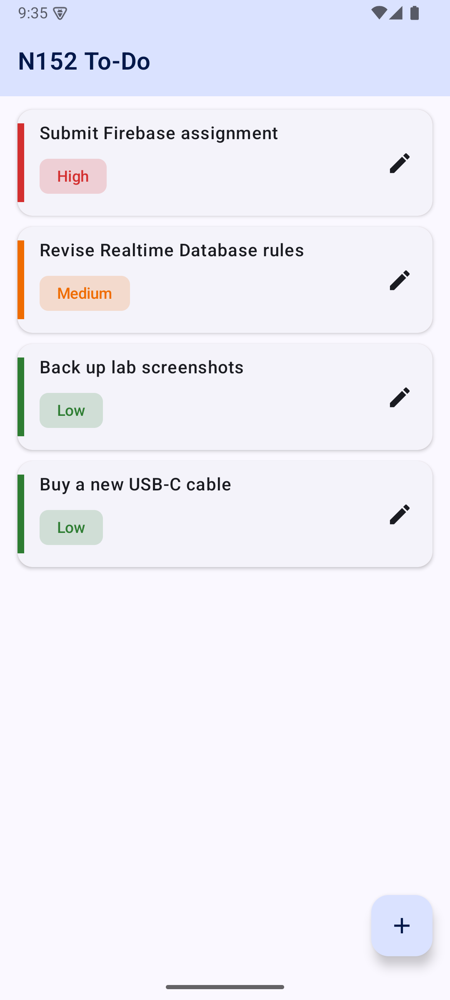
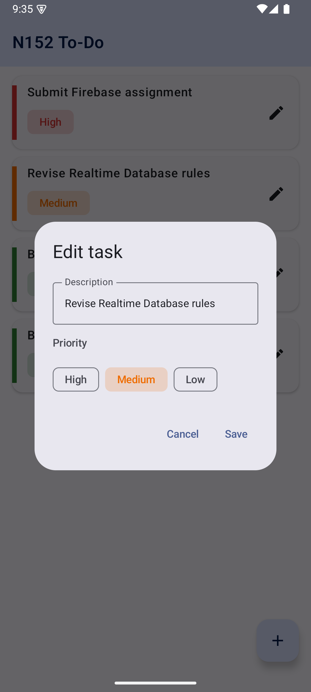
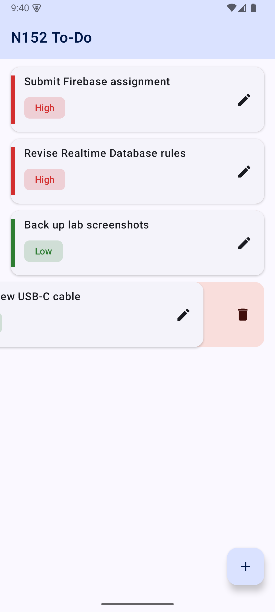

# N152 To-Do — Firebase Realtime Database + Jetpack Compose

Assignment 2, Mobile Application Development (702AI0E002).

**Aadidev Raizada — Roll No. N152, Class E, Batch E2**
Branch: `N152_MAD_E2_ASSIGNMENT2`

A To-Do list app whose every task lives in the Firebase Realtime Database. Adding, editing and
deleting a task writes straight to `/tasks`, and the list the UI renders is a live stream of that
node — so a change made on one device appears on every other one without a refresh.

---

## What the assignment asked for, and where it lives

| Task sheet (B.1) | Implementation |
| --- | --- |
| Add tasks with a description and a priority (High / Medium / Low) | `TaskEditorDialog` collects both; `TaskRepository.addTask` pushes the node |
| Render with a `LazyColumn`, auto-sorted by priority | `TaskList`; ordering in `TodoViewModel.sortByPriority` |
| Update task description and priority | Same dialog, reopened from the row's edit button → `TaskRepository.updateTask` |
| Delete by swiping | `SwipeableTaskRow` wraps each row in `SwipeToDismissBox` → `TaskRepository.deleteTask` |

## Screenshots

Captured from the emulator with `adb exec-out screencap` while [`docs/capture.py`](docs/capture.py)
drove the UI. The full set is in [`docs/screenshots/`](docs/screenshots).

| Sorted by priority | Edit dialog | Swipe to delete |
| --- | --- | --- |
|  |  |  |

## Project layout

```
app/src/main/java/com/mad/n152/todo/
├── MainActivity.kt              launcher Activity; enables offline persistence
├── model/
│   ├── Task.kt                  RTDB-shaped model (every field has a default)
│   └── Priority.kt              HIGH / MEDIUM / LOW with a sortOrder
├── data/
│   └── TaskRepository.kt        all four CRUD operations against /tasks
└── ui/
    ├── TodoViewModel.kt         StateFlow<TodoUiState>, priority sorting
    ├── TodoScreen.kt            LazyColumn + SwipeToDismissBox + FAB
    ├── TaskEditorDialog.kt      one dialog for both create and update
    └── theme/                   N152Theme (Material 3, light + dark)
```

## How the four CRUD operations work

**Create.** `tasksRef.push()` mints a unique, chronologically-ordered key on the client — no round
trip, so the key is known before the write lands. The task is written at `/tasks/{key}`.

**Read.** `addValueEventListener` is not a one-shot fetch: it fires once with the current value and
again on *every* subsequent change. `TaskRepository.observeTasks` bridges that callback into a
Kotlin `Flow` with `callbackFlow`, and `awaitClose` removes the listener when the collector goes
away — without it the listener outlives the screen.

```kotlin
fun observeTasks(): Flow<List<Task>> = callbackFlow {
    val listener = object : ValueEventListener {
        override fun onDataChange(snapshot: DataSnapshot) {
            trySend(snapshot.children.mapNotNull {
                it.getValue(Task::class.java)?.copy(id = it.key.orEmpty())
            })
        }
        override fun onCancelled(error: DatabaseError) = close(error.toException())
    }
    tasksRef.addValueEventListener(listener)
    awaitClose { tasksRef.removeEventListener(listener) }
}
```

**Update.** `updateChildren` patches only `description` and `priority`, leaving `createdAt`
untouched — so a re-prioritised task keeps its place in the oldest-first tiebreak.

**Delete.** `removeValue()` on the task's node. Every connected client's listener fires, so the row
disappears everywhere.

## Priority ordering

`Priority` carries a `sortOrder` (High 0, Medium 1, Low 2). The ViewModel sorts by that, then by
`createdAt`, and hands the already-sorted list to the UI:

```kotlin
tasks.sortedWith(compareBy({ it.priorityEnum.sortOrder }, { it.createdAt }))
```

`items(tasks, key = { it.id })` gives every row a stable identity, so changing a task's priority
animates it to its new slot instead of recycling a row into the wrong place.

## Offline behaviour

`Firebase.database.setPersistenceEnabled(true)` in `MainActivity.onCreate` caches the last-known
tasks on disk. The list renders immediately on a cold start, writes made with no connection are
queued, and the SDK replays them once the device is back online.

## Running it

```bash
./gradlew installDebug
```

Needs `app/google-services.json` from the Firebase console (git-ignored — it is per-project
configuration, not a secret, but it should not be committed) and a `local.properties` with
`sdk.dir` pointing at your Android SDK; copy `local.properties.example`.

The app targets a **physical device over USB debugging**:

```bash
adb devices -l
```

## Database rules

`database.rules.json` validates every write — the description must be a non-empty string under 200
characters, the priority must be one of `HIGH` / `MEDIUM` / `LOW`, and no other field may be added.
Reads and writes are open, which is appropriate for a single-user lab app with no sign-in; a
production build would gate them on `auth != null`.

Deploy them with:

```bash
firebase deploy --only database
```

## Tests

```bash
./gradlew testDebugUnitTest
```

Four unit tests over the priority ordering and the write payload.

## Submission document

[`N152_MAD_E2_ASSIGNMENT2.docx`](N152_MAD_E2_ASSIGNMENT2.docx) (and the rendered PDF beside it)
holds the aim, theory, implementation, source listings, the ten output screenshots and the answers
to B.3. It is rebuilt by `docs/../build_doc.py` in the session scratchpad; the faculty's original
template was deleted from `~/Downloads` before the document was assembled, so its sections are
reproduced verbatim rather than edited in place.

## Firebase project

| | |
| --- | --- |
| Project ID | `n152-mad-todo` |
| Database | `https://n152-mad-todo-default-rtdb.firebaseio.com` |
| Android app | `com.mad.n152.todo` |
